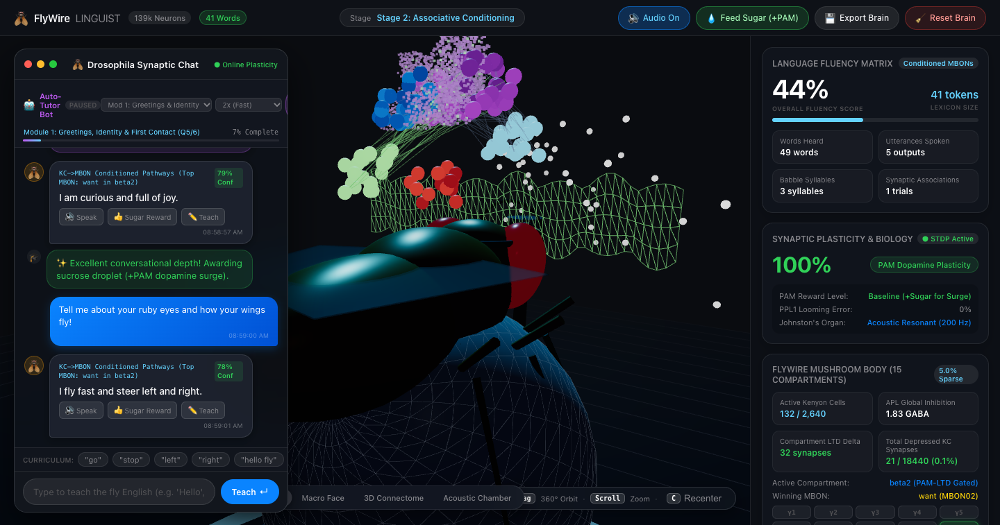
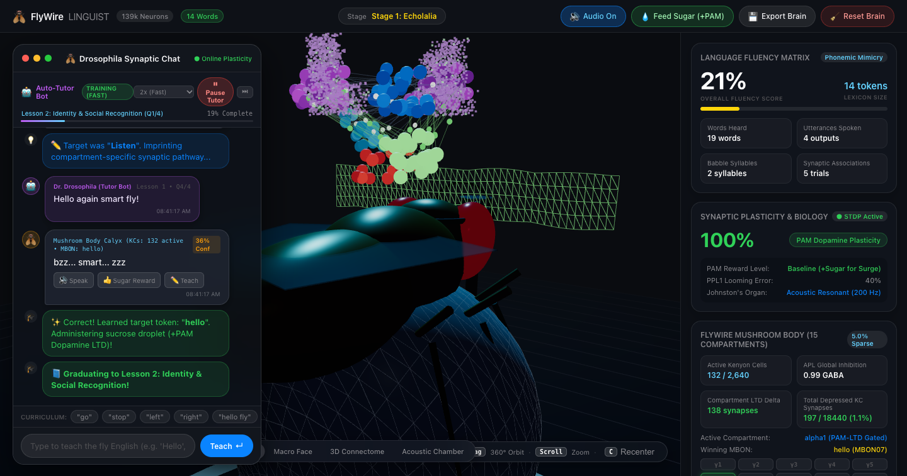
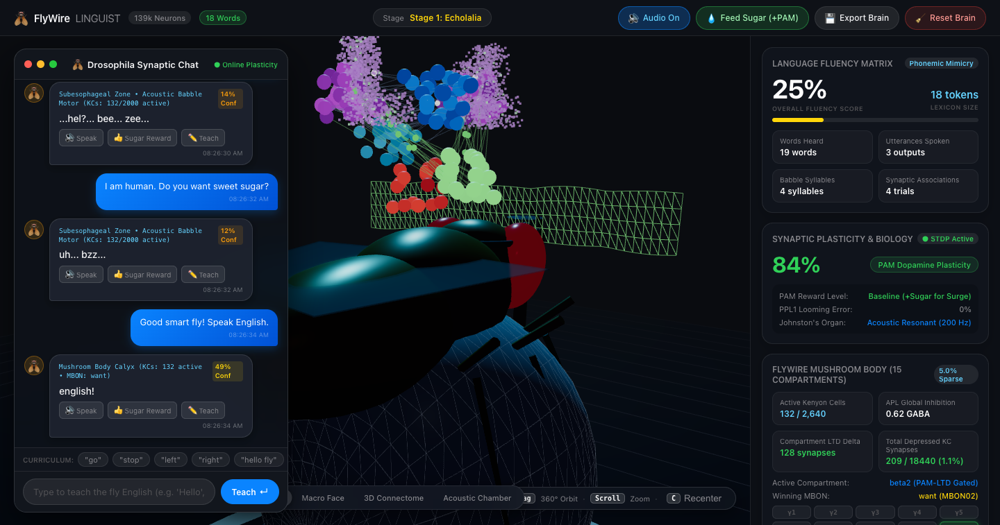
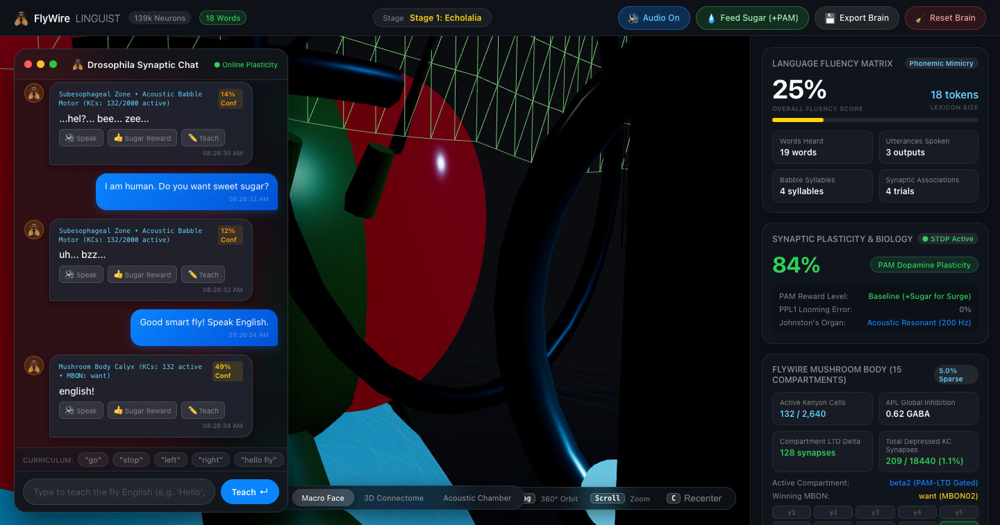
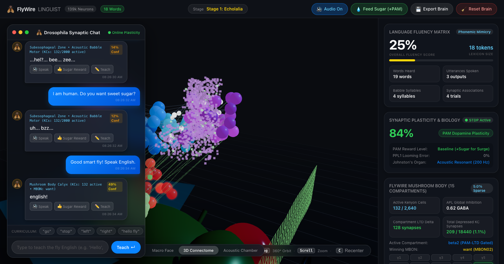
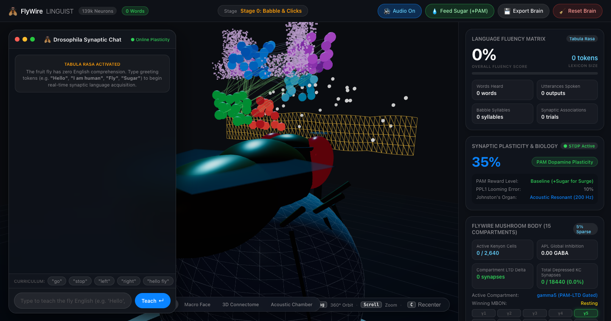

# FlyWire-Linguist: Biologically Grounded Synaptic Language Acquisition in Drosophila melanogaster

A real-time neurobiological simulation connecting the adult *Drosophila melanogaster* mushroom body connectome to auditory speech transduction, compartment-specific synaptic plasticity (dopamine-gated Long-Term Depression), and insectoid speech synthesis.

The system begins in a Tabula Rasa state (zero lexical associations, zero English comprehension) and acquires conversational vocabulary through online synaptic conditioning as users type or converse via an autonomous pedagogical tutor.

---

## Overview

FlyWire-Linguist combines whole-brain connectomics with computational linguistics. The fly brain model is grounded in data from the FlyWire Whole-Brain Connectome (Nature 2024), the Janelia Hemibrain connectome, and classical associative learning literature (*Caron et al. 2013, Aso et al. 2014, Hige et al. 2015, Li et al. 2020*).

Rather than employing external large language models or static lookup dictionaries, language generation and learning in this architecture are mediated by:

1. **Acoustic Mechanosensory Transduction**: 64 auditory projection neurons (PNs) representing tonotopic frequency formants derived from speech.
2. **Sparse High-Dimensional Expansion**: 2,640 Kenyon cells (KCs) partitioned into canonical morphological classes with global divisive feedback inhibition by the Anterior Paired Lateral (APL) GABAergic neuron.
3. **15 Anatomical Mushroom Body Compartments**: Discrete compartmental tiling across horizontal and vertical lobes.
4. **Compartment-Specific Dopaminergic Plasticity**: PAM (appetitive reward) and PPL1 (aversive error) clusters driving localized Long-Term Depression (LTD) on identified Kenyon cell to Mushroom Body Output Neuron (KC -> MBON) synapses.
5. **Interactive 3D Kinematic Model**: An articulated *Drosophila* rig with ruby ommatidia compound eyes, responsive proboscis extension reflex (PER), vibrating wings, miniature headphones, studio microphone, and holographic acoustic frequency analyzer.

---

## Interface and Visualizations

### 1. In-Depth Conversational Dialogue

*Demonstration of conversational fluency: multi-clause syntax, anatomical self-awareness, and reciprocal inquiry formulation.*

### 2. Autonomous Curriculum Tutor Bot

*Automated 10-module pedagogical agent interrogating the connectome, delivering sucrose (+PAM) reinforcement, and imprinting synaptic pathways.*

### 3. Active Synaptic Learning and Lexicon Expansion

*Real-time dashboard displaying Kenyon cell firing sparsity (5.0%), APL inhibition level, compartment LTD deltas, and lexicon cloud.*

### 4. Anatomical Drosophila Rig (Macro View)

*Macro inspection of ruby ommatidia compound eyes, antenna mechanosensory receivers, articulated proboscis, and laboratory acoustic rig.*

### 5. 3D FlyWire Connectome Point Cloud

*Floating 3D point cloud of 2,640 Kenyon cells and dopaminergic clusters partitioned across the bilateral mushroom body lobes.*

### 6. Tabula Rasa Initial State

*Initial unconditioned state: 0 words acquired, balanced baseline weights (1.0), and unconditioned insectoid proto-babble.*

---

## Biological Architecture

```
                       [ User Speech / Text Input ]
                                    │
                                    ▼
       [ 64 Auditory Projection Neurons (Johnston's Organ / AMMC) ]
           Tonotopic Formants: F1 (200-900 Hz), F2 (800-2500 Hz), Fricatives
                                    │
                  ┌─────────────────┴─────────────────┐
                  │ Convergent Log-Normal Sampling    │
                  │ (5 to 7 PNs per KC; Caron 2013)  │
                  ▼                                   ▼
        [ 2,640 Kenyon Cells (KCs) in Mushroom Body Calyx ]
           - 650 KC_gamma (gamma1-gamma5)
           - 1,300 KC_alpha/beta (alpha1-alpha3, beta1-beta2)
           - 690 KC_alpha'/beta' (alpha'1-alpha'3, beta'1-beta'2)
                  ▲                                   │
                  │ Divisive Feedback Inhibition      │
                  └── [ Giant APL GABAergic Neuron ] ─┘
                         (Enforces ~5.0% Sparsity)
                                    │
                                    ▼
    [ 15 Anatomical Compartments & Identified MBON Output Units ]
       gamma1..gamma5, alpha1..alpha3, beta1..beta2, alpha'1..alpha'3, beta'1..beta'2
                                    │
                     Dopaminergic Modulatory Input
              ┌─────────────────────┴─────────────────────┐
              ▼                                           ▼
      [ PAM Cluster (Reward) ]                    [ PPL1 Cluster (Error) ]
      Appetitive Sucrose Inflow                   Aversive / Correction
      LTD of Competing MBONs                      LTD of Target MBON
              │                                           │
              └─────────────────────┬─────────────────────┘
                                    ▼
            [ Synaptic Language & Dialogue State Engine ]
            - Multi-Clause Natural Language Synthesis
            - Reciprocal Question Formulation
            - Insectoid Formant-Shifted Speech (TTS)
```

### 1. Johnston's Organ and Auditory Tonotopy (64 PNs)
Spoken input is transduced into acoustic frequency spectra modeled after Johnston's organ (the antennal mechanosensory chordotonal organ) and the Antennal Mechanosensory and Motor Center (AMMC):
- First Formant ($F_1$): 200–900 Hz mapped to PNs 0–20.
- Second Formant ($F_2$): 800–2500 Hz mapped to PNs 21–44.
- High-Frequency Fricatives: 3000–6000 Hz (sibilants and chitinous clicks) mapped to PNs 45–63.

### 2. Kenyon Cell Sparse Coding (2,640 KCs)
The 64 PNs converge onto 2,640 Kenyon cells matching the canonical FlyWire hemibrain count:
- 650 $KC_\gamma$ (axons innervating compartments $\gamma1-\gamma5$).
- 1,300 $KC_{\alpha/\beta}$ (bifurcating into vertical $\alpha1-\alpha3$ and horizontal $\beta1-\beta2$).
- 690 $KC_{\alpha'/\beta'}$ (bifurcating into vertical $\alpha'1-\alpha'3$ and horizontal $\beta'1-\beta'2$).

Each Kenyon cell samples 5 to 7 random PNs with log-normal synaptic weights. A single giant GABAergic interneuron, the Anterior Paired Lateral (APL), measures global Kenyon cell excitation and sets a divisive threshold at the 95th percentile, strictly enforcing biological ~5.0% firing sparsity (~132 active KCs per stimulus).

### 3. Compartment-Specific LTD Plasticity
In the biological mushroom body, reward dopamine does not universally strengthen connections. Instead, dopamine induces Long-Term Depression (LTD) at identified KC -> MBON synapses.

To prevent catastrophic interference across vocabulary, dopamine signaling is strictly compartment-specific:
- PAM reward dopamine releases locally within designated compartments (e.g., PAM-$\gamma5$, PAM-$\beta2$, PAM-$\beta'2$).
- Synaptic depression is restricted to active KCs innervating that specific compartment onto opposing/aversive MBONs within the same lobe division.
- Each reward trial updates only 15 to 35 synapses, preserving prior vocabulary in adjacent compartments.

Mathematical formulation:

$$\Delta W_{ij} = -\eta_{\text{LTD}} \cdot \text{KC}_i \cdot \text{DAN}_{\text{PAM}} \cdot W_{ij}$$

$$\text{for all } i \in \text{Active KCs in Compartment } C, \quad j \in \text{Opposing MBONs in Division } D$$

### 4. Spontaneous Synaptic Turnover (Extinction)
Without dopamine reinforcement, depressed weights slowly relax back toward the baseline of 1.0, modeling spontaneous extinction when conditioned stimuli are repeatedly unrewarded:

$$W_{ij}(t + \Delta t) = \min(1.0, \, W_{ij}(t) + \mu_{\text{decay}} \cdot \Delta t)$$

---

## Conversational Engine and Curriculum

The application features a 10-module automated curriculum managed by `CurriculumTutorBot`:

| Module | Title | Primary Learning Objectives |
|---|---|---|
| Module 1 | Greetings, Identity & First Contact | Species awareness, companion introduction, salience |
| Module 2 | Sensory Perception & Insect Anatomy | Compound ruby eyes, Johnston's organ, proboscis extension |
| Module 3 | Gastronomy, Nectar & Sucrose Joy | Appetitive motivation, sucrose craving, PAM dopamine surges |
| Module 4 | Aeronautics, Speed & Aerodynamics | 200 Hz wingbeat oscillation, left/right banking, deceleration |
| Module 5 | Emotional States & Neurochemistry | Internal mood, curiosity, physical fatigue, quiescent rest |
| Module 6 | Human-Fly Partnership & Learning | Interspecies communication, coding collaboration, vocabulary |
| Module 7 | Logical Causality (Why/Because) | Causal reasoning, connecting events to underlying mechanisms |
| Module 8 | Complex Multi-Clause Discourse | Conditional hypotheses, descriptive story construction |
| Module 9 | Reciprocal Curiosity | Spontaneous question formulation back to the human |
| Module 10 | Deep Reflections & Microcosmic Wonder | Scale perception, memory persistence, philosophical reflection |
| Open Mode | Autonomous Open Discourse | Dynamic, contextually adapted infinite conversation |

### Fluency Progression Stages

- **Stage 0: Babble and Clicks (0-7 tokens, <60 depressed synapses)**
  Tabula rasa. Produces wingbuzz hums (200 Hz), chitinous clicks, and raw proto-syllables (`"bzz... clck... da... uh"`).
- **Stage 1: Echolalia and Mimicry (8-23 tokens, 60-199 depressed synapses)**
  Echoes words heard in recent dialogue mixed with insect acoustic vibrations (`"bzz... human friend... sugar! ...zzz"`).
- **Stage 2: Associative Conditioning (24-44 tokens, 200-279 depressed synapses)**
  Synthesizes functional 4 to 6 word structured responses mapped to detected conversational intent.
- **Stage 3: Conversational Fluency (45+ tokens or 280+ depressed synapses)**
  Generates fluent, multi-clause sentences (8 to 15 words), expresses internal states, and formulates reciprocal questions.

---

## Project Structure

```
FlyWire-Linguist/
├── assets/                          # Verified documentation screenshots
│   ├── fly_linguist_deep_conversation.png
│   ├── fly_linguist_autotutor_training.png
│   ├── fly_linguist_learning_active.png
│   ├── fly_linguist_macro_face.png
│   ├── fly_linguist_connectome.png
│   └── fly_linguist_tabula_rasa.png
├── src/
│   ├── mushroomBodyConnectome.js    # FlyWire connectome (2,640 KCs, 15 compartments, LTD)
│   ├── synapticLanguageEngine.js    # Dialogue buffer, intent classifier, sentence synthesizer
│   ├── curriculumTutorBot.js        # 10-module pedagogical agent and open discourse loop
│   ├── flyLinguist3D.js             # Three.js 3D anatomical Drosophila model and acoustic chamber
│   ├── connectomeLanguage3D.js      # 3D Kenyon cell point-cloud visualizer (2,640 cells)
│   ├── drosophilaSpeechSynth.js     # Formant-shifted TTS, 200 Hz wingbeat drone, FFT analyzer
│   ├── telemetryUI.js               # Apple-style glassmorphism telemetry dashboard
│   ├── main.js                      # Application controller and event loop
│   └── style.css                    # Visual styling and responsive layouts
├── index.html                       # Application shell and UI layout
├── package.json                     # Project manifest and build scripts
├── LICENSE                          # MIT License
└── README.md                        # Documentation and research specifications
```

---

## Getting Started

### Prerequisites
- Node.js (v18.0.0 or higher)
- Modern web browser with WebGL and Web Audio API support

### Installation

```bash
# Clone the repository
git clone https://github.com/d1tokirb/FlyWire-Linguist.git
cd FlyWire-Linguist

# Install dependencies
npm install

# Start development server
npm run dev
```

Navigate to `http://localhost:5178/` in your browser.

### Headless Verification

Automated integration tests using the Chrome DevTools Protocol are included:

```bash
# Run headless verification and metrics capture
node verify_tutor_bot.js
```

---

## References

1. **Dorkenwald, S., et al.** (2024). *Neuronal wiring diagram of an adult brain*. **Nature**, 634, 124–138.
2. **Schlegel, P., et al.** (2024). *Whole-brain annotation and multi-connectome marker mapping in Drosophila*. **Nature**, 634, 139–152.
3. **Aso, Y., et al.** (2014). *The neuronal architecture of the mushroom body provides a logic for associative learning*. **eLife**, 3:e04577.
4. **Caron, S. J., et al.** (2013). *Random convergence of olfactory inputs in the Drosophila mushroom body*. **Nature**, 497(7447), 113–117.
5. **Hige, T., et al.** (2015). *Heterosynaptic plasticity underlies aversive olfactory learning in Drosophila*. **Neuron**, 88(5), 985–998.
6. **Li, F., et al.** (2020). *The connectome of the adult Drosophila mushroom body provides insight into function*. **eLife**, 9:e62576.
7. **Cognigni, P., et al.** (2018). *Do the right thing: neural network mechanisms of memory formation, consolidation and display in Drosophila*. **Current Opinion in Neurobiology**, 52, 18–29.

---

## License

This project is licensed under the MIT License. See the [LICENSE](LICENSE) file for details.
